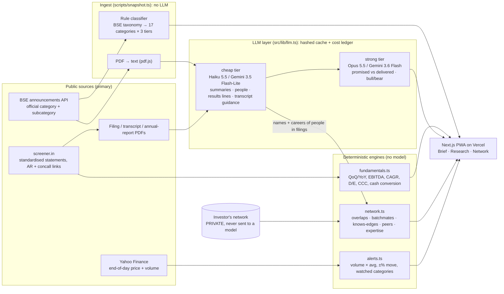

# FINN: architecture, data, privacy, models

## 1. One picture

**Principle: numbers come from code, words come from models, and the network never goes to a model.**

## 2. Data pipelines

| Data | Source | How it's fetched | Refresh (prototype → production) | Stored as |
|---|---|---|---|---|
| Filings | BSE `AnnSubCategoryGetData` API (per scrip, paginated) | `src/lib/sources/bse.ts` | snapshot → poll every 5 min in market hours | `data/snapshot/feed.json` |
| Filing text | Attachment PDFs on bseindia.com | `src/lib/sources/pdf.ts` (pdf.js), first 6–12 pages | on arrival | `data/snapshot/texts/<id>.txt` |
| EOD prices | Yahoo chart endpoint (`.NS`) | `src/lib/sources/yahoo.ts` | daily after close (~18:00 IST) | in `feed.json` |
| Fundamentals | screener.in company page | `src/lib/sources/screener.ts` (cheerio) | snapshot, or live with `"use cache"` for 1 day | `data/snapshot/companies/<SYM>.json` |
| Transcripts, annual reports | links from screener.in → BSE PDFs | fetched on demand in Research | on new concall / AR | LLM extracts cached by content hash |
| Network | investor-provided (synthetic here) | `data/network.json` | user edits / CRM sync | private store |

**Why BSE and not NSE?** NSE's JSON API rejects scripted clients (HTTP 403). BSE's API works, returns its own category and subcategory labels, and carries full history. screener.in only exposes about 10 recent filings without login. NSE's public RSS is reachable and is the natural live trigger for production.

**Why a committed snapshot?** Exchanges block datacenter IPs unpredictably, and "a demo that doesn't run is the worst outcome". The demo set is pre-fetched. Research on any other ticker runs live.

**Linking entities**
- *Ticker ↔ company ↔ BSE code:* the screener page links to BSE with the scrip code. One fetch resolves everything.
- *Filing ↔ person:* the cheap model extracts `{name, role, action, prior employers + years, education}` from the Regulation 30 annexure. SEBI requires a "brief profile" of appointees, so the filing itself is the primary source for the bio.
- *Person ↔ network:* deterministic.
  - Names: token-subset matching that ignores honorifics and middle names.
  - Organisations: normalised and checked against an alias table (`TPDDL` = `Tata Power-DDL` = `Tata Power Delhi Distribution`).
  - Same organisation with ≥1 year of tenure overlap counts as **colleague**. Same school within 2 years counts as **batchmate**. An explicit `knows` edge counts as **second-degree**.
  - Each match is scored by tie strength decayed by months since last contact, and always comes with a human-readable reason.
- *Company ↔ network:* current employee = **insider**, with a compliance hint. Then **ex-insider**, weighted by recency. Then **peer**, meaning the same exchange industry or a shared theme tag like "semiconductors" or "rural lending". Then **sector expert**.

## 3. Use of LLMs and agents

| Step | Tier | Why a model | Guardrails |
|---|---|---|---|
| Filing one-liner + materiality | cheap | turns "Announcement under Regulation 30 (LODR)-General" into a sentence | filing text only; zod-validated JSON |
| People in management changes | cheap | free-text annexures vary wildly | must quote the filing; years only if stated |
| Results lines when the standardised table lags | cheap | copy three columns of a table | **no arithmetic by the model**: EBITDA = PBT + finance cost + D&A − other income is computed in code. Only the P&L table pages are sent; every copied figure must appear digit-for-digit in the filing, and PAT/PBT must be plausible in every column, or the numbers are dropped. Cross-checked against screener when both exist |
| Transcript guidance extraction (map) | cheap | find explicit promises + verbatim quotes in a 40-page call | quotes must be verbatim; outside knowledge forbidden |
| Promised vs delivered, narrative vs numbers, bull/bear (reduce) | strong | genuine reasoning across 4 quarters + a numbers table | numbers table (incl. capex = CFO − FCF) computed in code; a later call can settle an earlier promise (re-set against the investor = missed, in their favour = raised); company-defined metrics are never judged against a differently-defined table row; "unverifiable" and "pending" are explicit verdicts |

What is **not** a model call:
- Classifying ~400 filings (rules on BSE's own taxonomy; milliseconds, free)
- Tiering and grouping
- Every financial ratio
- Alerts
- All network matching

**Agents.** None act autonomously. Research is a fixed map→reduce workflow, which gives predictable cost, auditable steps, and progress streamed to the UI. An open-ended agent is the right next step for natural-language questions across tools (`search_filings`, `fundamentals`, `find_people`). It's deliberately left out until there are evals to keep it honest.

**Cost controls**
- Every call is cached by `sha256(model, prompt, schema)`, so re-runs are free.
- System prompts are frozen strings, so the cached prefix hits on Claude.
- Bulk work runs at low effort. Only the reduce step runs at high effort.
- A cost ledger is written to `data/snapshot/llm-ledger.json`.
- Live research has a per-day cap (`RESEARCH_DAILY_LIMIT`).
- Gemini's free tier works for everything, so the prototype can run at **$0**.

## 4. Data security and privacy

**Prototype**
- The network is a clearly-labelled synthetic file.
- Real people appear only through public exchange disclosures, such as an appointee's profile in a Regulation 30 filing.
- No personal data is sent to any model.
- The demo's AI ran on Gemini's free tier, whose terms let Google use prompts to improve its products. That's acceptable here only because every prompt is a public exchange filing or transcript. Production would use a paid tier with no-training, zero-retention terms.

**Production design**
- **Isolation.** Each investor's network lives in their own tenant, either Postgres with row-level security keyed on the user or an on-device store. It's encrypted at rest with a per-tenant key. Matching runs in-process; the network is never in a prompt and never in logs.
- **What we store.** Only professional fields: employers with years, titles, schools, expertise tags, tie strength, last contact, and the investor's own notes. No contact details beyond what the investor chooses to keep. People named in filings are stored with a link to the filing, since that is public data.
- **Where it comes from, with consent.**
  - The investor imports their own data: a CSV or vCard, or LinkedIn's "Get a copy of your data" Connections export, which is the user's own data.
  - Enrichment comes from a licensed people-data provider under a DPA, not scraping, which LinkedIn's terms prohibit.
  - Contacts can be shown what is held about them and can ask for it to be removed.
- **Retention.**
  - Contacts are kept until deleted, and a "forget" deletes from all stores and caches.
  - Enrichment of public filings is kept indefinitely.
  - Raw call notes are kept for a configurable period, e.g. 24 months.
- **Access control.** SSO with role-based access (an analyst can't see a PM's private network), and an audit log of who viewed which person.
- **Compliance.** Insiders are flagged ("mind what you ask an insider") as an MNPI guard. The design aligns with India's DPDP Act 2023: purpose limitation, consent records, and access, correction and erasure rights.
- **Model providers.** Only public documents are sent, under zero-data-retention terms where available.

## 5. Cloud: what runs where

| Piece | Prototype | Production |
|---|---|---|
| App (UI + API routes) | Vercel (Next.js 16, Fluid compute; Mumbai region recommended) | same |
| Ingestion | `npm run snapshot` locally (residential IP, since exchanges block datacenters) | small worker on an Indian IP (e.g. a Mumbai VM or Cloud Run job via egress proxy), every 5 min in market hours plus EOD |
| Storage | JSON in the repo | Postgres (Neon/Supabase, ap-south-1) + R2/S3 for PDFs + pgvector for transcript chunks |
| Enrichment | `npm run enrich` | queue-triggered on each new filing (cheap tier) |
| Alerts | computed in the client from EOD data | server-side rules → Web Push / APNs |
| LLMs | Anthropic or Gemini API | same, routed by tier, with batch API for overnight backfills (50% cheaper) |
